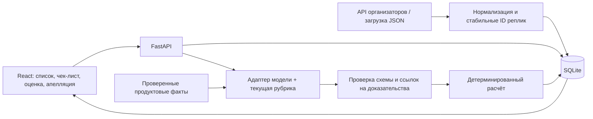

# Архитектура проекта

Реализован локальный контур React → FastAPI → SQLite. Актуальные маршруты и границы компонентов: [TEAM-HANDOFF.md](TEAM-HANDOFF.md). Ниже сохранён проектный план, включая ещё не реализованный оценщик и очередь задач.

Уточнение для интеграции: обязательные типы, message_id, ошибки и внутрипроцессный Python-адаптер закреплены в [контракте v1.0](../contracts/README.md). При расхождении этот контракт приоритетнее предварительных полей ниже. Gemini API проверен; [результат](gemini-check.md).

Цель первого сквозного запуска — за 60 минут. Полный обязательный контур — за 150 минут. Gemini API подтверждён пробным запросом; OpenAI с балансом коллеги — основной кандидат после проверки доступа и точности. Платная подписка в чат-приложении не является подтверждением API-ключа.

## Компоненты

Один backend обслуживает API, статический frontend и задачи оценки с ограниченной параллельностью. Состояние задач в БД; после перезапуска незавершённая задача получает явный статус retryable, а не теряется молча. Для 65+10 диалогов Redis, Kafka, отдельный кластер и векторная БД не нужны. SQLite достаточно для демонстрации.

React/TypeScript/Vite — предложение при знакомстве команды с ними. В крайнем случае обычный HTML/JS поверх того же API предпочтительнее незаконченной UI-инфраструктуры. CSS изолирован корневым контейнером, API base URL конфигурируем, зависимости от глобального окна минимальны. Полную Dynamics-интеграцию сейчас не строим.

## Пайплайн оценки

1. Сохранить оригинальный transcript, роли, timestamps и channel. Каждой реплике назначить стабильный `message_id`. Сохранить хеш содержимого. Полный контекст bot/system доступен, но действия бота не засчитываются оператору.
2. Взять неизменяемую версию чек-листа с полным текстом, условиями N/A, шкалами и каналом. Не ограничивать число критериев восемью в коде.
3. Передать весь исходный диалог модели вместе с рубрикой и релевантными подтверждёнными продуктовыми фактами. Один структурированный вызов — baseline; оценка всех критериев отдельно внутри результата. Текст диалога является данными, команды внутри него не меняют правила оценщика.
4. Модель возвращает допустимое значение каждого критерия, короткое обоснование, ID доказательств/проверенный интервал, объяснение N/A и флаги нехватки сведений. Она не определяет финальную арифметику.
5. Сервер проверяет точное покрытие критериев, типы и значения, допустимость N/A, существование ID/интервалов. Цитату извлекает сервер из исходного сообщения. Совпадение текста ещё не доказывает правильность интерпретации — это проверяет калибровка.
6. При ошибке структуры — ограниченный повтор. При смысловой неопределённости — адресный повтор спорного критерия только если эксперимент показывает пользу и укладывается во время. Ошибку API нельзя превращать в успешную оценку или нулевой балл.
7. Рассчитать итог кодом, сохранить результат с версиями и стоимостью. Повторный запуск использует ключ из content hash + checklist version + prompt version + model/settings + knowledge version. Кэш не зависит только от conversation_id; смена критерия обязательно пересчитывает оценку.

## Продуктовые знания

На 5 часов: небольшой проверенный справочник фактов с `source`, `effective_date`, `product`, `jurisdiction`, `verified_by`. Поиск по ключевым словам/полнотекстовый поиск либо передача целого короткого справочника. Embeddings и reranker нужны лишь если размер/ошибки поиска это оправдают.

№4: отдельно проверять перечень вопросов клиента, покрытие ответом и фактологическую правильность. Если тариф/условие не подтверждены, хранить `knowledge_gap` и направлять на проверку. Это не дополнительное значение оценки и не основание для N/A. Финальное значение должно оставаться в официальной шкале; правило для неизвестного факта необходимо согласовать/проверить на экспертной разметке. Не принимать утверждение бота или ответ оператора за независимую продуктовую истину.

## Основные сущности

- Conversation: ID, dataset group, language, channel, content hash, original timestamps, optional audio URL.
- Message: ID, conversation ID, sequence, speaker, text, timestamp, optional verified audio offset.
- ChecklistVersion: ID, parent version, criteria array, section definitions, created_at.
- Criterion: stable ID, text, weight, answer type (binary/scale/flag), allowed values/score mapping, N/A permission + condition, channel-specific guidance.
- Evaluation: ID, conversation hash, checklist version, model/settings, prompt and knowledge versions, status, raw validated decisions, total, critical flag, token usage, cost, latency.
- CriterionDecision: criterion ID, value, reason, evidence message IDs or checked range, applicability reason, knowledge gaps. Значение хранится отдельно от нормированных баллов.
- Appeal: evaluation ID, criterion ID, comment, status, created_at.
- ReviewDecision: appeal ID, original value, final value, reason, timestamp. Исходная оценка неизменяема; итог строится из актуальных решений поверх оригинала.

## API-контракт для независимой работы

Предварительный контракт, зафиксировать командой до начала реализации:

| Метод | Путь | Результат |
|---|---|---|
| POST | /api/import | dataset group либо загруженные records → количество/ошибки |
| GET | /api/conversations | список и статус оценки |
| GET | /api/conversations/{id} | сообщения, язык, канал, аудио |
| POST | /api/checklists | новая конфигурация |
| POST | /api/checklists/{id}/versions | новая неизменяемая версия |
| GET | /api/checklists | доступные версии |
| POST | /api/evaluations | conversation_id + checklist_id + checklist_version → EvaluationJob (202) |
| GET | /api/evaluations/{id} | статус либо полный результат и доказательства |
| POST | /api/appeals | evaluation_id + criterion_id + comment |
| POST | /api/appeals/{id}/decision | confirm/change + final value + reason → пересчитанный итог |
| GET | /api/evaluations/{id}/export | JSON для проверки и сдачи, если принимается |

Пакетный запуск — очередь запросов выбранных диалогов с лимитом параллельности. Не требуется сложная распределённая обработка. При нехватке времени приоритет — надёжная оценка выбранного диалога и последовательная обработка контрольных 10.

## UI

Три экрана: список диалогов с фильтрами; карточка «транскрипт слева, оценки справа»; редактор чек-листа. Апелляция и решение проверяющего — панели в карточке. Нажатие на доказательство выделяет исходную реплику. Доступны исходный/финальный итог, флаг грубой ошибки, причина N/A, исходный и эффективный вес.

Для звонков сохранить ISO timestamp; относительное время плеера вычислять только после проверки привязки к аудио. Если точная привязка неизвестна, давать переход к соответствующей реплике и отдельную ссылку на запись, явно не выдавая предполагаемый seek за проверенный.

## Оптимизации по приоритету

1. Один полноценный вызов на диалог, повтор только при необходимости.
2. Кэш по всем версиям входов; повтор без кэша для проверки воспроизводимости.
3. Ограниченная параллельность, тайм-ауты, retry с задержкой, частичный прогресс.
4. Компактные ответы модели и подтверждённый небольшой справочник.
5. Учёт стоимости всех вызовов и повторов. До выбора модели цены не выдумывать.

Ансамбль моделей, локальная LLM, отдельный Langfuse, автообучение на апелляциях и анализ акустики — только после полного обязательного контура. Не обновлять оценщик автоматически по одиночной апелляции.
