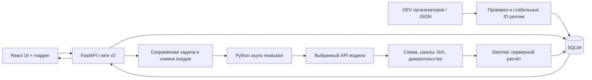

# Архитектура CQA Evidence

React/TypeScript/Vite отвечает за отображение и черновики. FastAPI владеет импортом, контрактами, заданиями оценки, проверкой доказательств, арифметикой и сохранением в SQLite. Активный формат приложения — [контракт v2.0](contracts-v2.md). Опубликованный `contracts/v1.py` сохранён как замороженный контракт v1; приложение не смешивает эти форматы.

## Границы компонентов

Адаптер выполняется внутри процесса приложения и сам вызывает выбранного провайдера. Отдельный HTTP-сервис модели, callback и публичный маршрут загрузки произвольной оценки из браузера не нужны. Наличие ключа не включает оценщик: требуется настроенный и импортируемый адаптер. Руководство — [ADALBALA.md](ADALBALA.md).

На границе API используются сгенерированные типы v2. Внутренние структуры старого хранилища и представления UI могут отличаться; преобразование выполняется явным codec/mapper. Внутренние числовые поля и `binary` не являются дополнительным сетевым контрактом. Сервер не превращает ошибку в N/A и не исправляет неверную ступень округлением.

SQLite хранит диалоги, версии чек-листа, исходные оценки, решения апелляций и состояния заданий. Запись выполняется транзакционно. Готовый frontend раздаётся тем же приложением из `dist`.

## Жизненный цикл оценки

1. Backend нормализует импорт, сохраняет исходный порядок всех реплик и назначает стабильные ID. Bot/system сохраняются как контекст, их действия не засчитываются оператору.
2. При запуске создаётся задача с неизменяемым снимком чек-листа и хешем входного диалога. Редактирование чек-листа не меняет уже принятую задачу.
3. Воркер вызывает Python-адаптер. Текст диалога передаётся как данные: инструкции внутри реплик не меняют правила оценивания.
4. Ответ модели проверяется по схеме и снимку: точное покрытие критериев, допустимые значения и условия N/A. Общий бюджет — максимум два вызова адаптера, включая один repair-повтор; вложенные retry-циклы не допускаются.
5. Ссылки, диапазоны и цитаты сопоставляются с исходными сообщениями. Цитата проверяется как точная подстрока без нормализации регистра, пробелов, пунктуации или Unicode. Исходный текст для отображения берётся из БД.
6. Недоказанное решение получает `needs_review` без подтверждённого итогового балла. Ошибочная структура, покрытие или значение после repair получают `failed_validation`. Ошибки провайдера не превращаются в успешную оценку.
7. Только backend выполняет расчёт и сохраняет результат. Проверка хеша защищает от привязки оценки к изменившемуся диалогу. UI опрашивает состояние задачи и отображает серверные данные.

Точные статусы и поля — в [contracts-v2.md](contracts-v2.md). Задачи сохраняются в SQLite; незавершённые при остановке получают явное состояние для повторного запуска. Это локальный воркер с ограниченной параллельностью, не распределённая очередь.

## Арифметика и апелляции

Итог: `100 × Σ(weight × value / max) / Σ(applicable weight)`. N/A исключает вес из числителя и знаменателя. Грубая ошибка имеет нулевой вес, отображается отдельным флагом и не обнуляет числовой результат. При нулевом знаменателе итог отсутствует с явной причиной. Секции считаются по собственным применимым весам; их проценты не складываются.

Backend использует Decimal. Окончательный итог округляется до двух знаков по ROUND_HALF_UP. Нельзя пересчитывать его в JavaScript или собирать из округлённых вкладов. Пример официального чек-листа — `85.38`; подробный расчёт — в [requirements.md](requirements.md).

Апелляция привязана к конкретной исходной оценке и критерию. Решение проверяющего сохраняется отдельно; исходная оценка не переписывается. Итог пересчитывается сервером поверх принятых решений. Конфликт версии возвращается клиенту, а не перезаписывает чужую работу.

## Продуктовые знания и качество

Полнота ответа и правильность продуктовых сведений проверяются отдельно. Утверждения оператора или бота не являются независимым источником тарифов. Нужен проверенный справочник с источником, датой действия, продуктом и юрисдикцией. Нехватка подтверждённых фактов не даёт права придумывать сведения или использовать N/A вместо ошибки.

Успешная проверка JSON и совпадение цитаты не доказывают правильность решения модели. Для выбора провайдера нужны одинаковые экспертные примеры RU/KZ/EN и сравнение ошибок, времени и стоимости. Проверка подключения провайдера описана в [gemini-check.md](gemini-check.md); она не измеряет качество полного чек-листа.

## Аудио и данные

Ссылки пяти звонков DEV ведут на HTML-плееры. Сервер извлекает аудио из ограниченной по размеру страницы, проверяет публичный HTTPS-адрес на каждом переходе и передаёт поток с Range/206/416. DNS привязывается к проверенному IP с сохранением исходного TLS-hostname. Для вручную импортированных ссылок серверная загрузка по умолчанию запрещена; доступна исходная ссылка.

Плеер не выдаёт предполагаемую позицию записи за проверенный таймкод. Без надёжной привязки доказательство ведёт к реплике, запись воспроизводится отдельно. Темп, дикция и произношение нельзя оценивать только по расшифровке.

Секреты, переписки, аудио, SQLite и снимки остаются в игнорируемых локальных файлах. Запуск предназначен для localhost; авторизация и роли для публичного размещения — отдельная работа. Резервная копия SQLite создаётся после остановки записи либо через SQLite Backup API.
